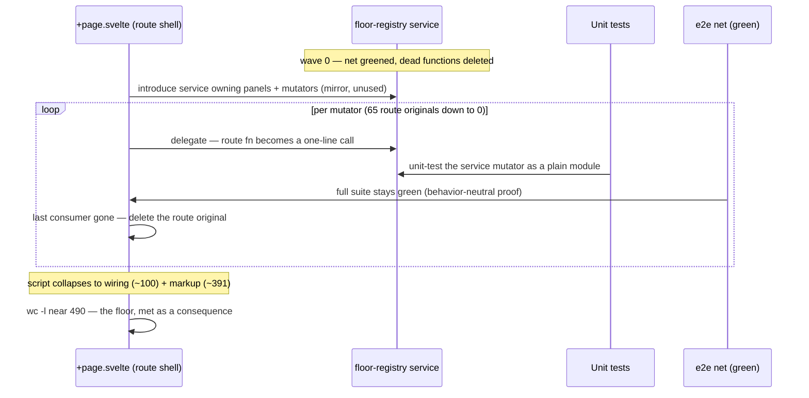
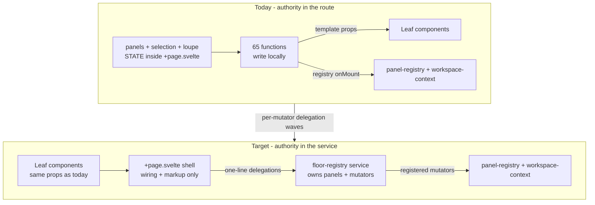

# ADR-0019 — The Floor Registry: The Machine Moves Whole, the Shell Stays Thin

| | |
|---|---|
| **ADR ID** | 0019 |
| **Title** | The `+page.svelte` floor state machine (65 functions over one `panels` array) moves wholesale into an additive floor-registry service — one mutator delegation at a time behind a green e2e net — so the route collapses to wiring + markup and ADR-0018 D4's missed floor is met as a consequence, not by line-counting |
| **Status** | Implemented (2026-10-09 — see the amendment below; D5's line number carries an honest miss, recorded) |
| **Date** | 2026-10-09 |
| **Project** | deepseek-insight |
| **Companions** | [KB — Why the 500-Line Floor Missed](../../kb/component-graph/2026-10-09%20-%20Why%20the%20500-Line%20Floor%20Missed%20—%20Post-Implementation%20Measurement.md) (the facts section this ADR cites), [ADR-0018 — The Component Standard](2026-10-09%20-%20ADR-0018%20—%20The%20Component%20Standard%20—%20Thin%20Shells%2C%20Service%20State%2C%20Nine%20Crossings.md) (D2 state homes; D4 the failed promise this ADR re-plans), [ADR-0006 — The Panel Floor](../2026-08/2026-08-24%20—%20The%20Panel%20Floor%20—%20Many%20Conversations%2C%20One%20Page.md) (the leaf→root registry this generalizes to service scale) |
| **Supersedes** | Nothing — it executes what ADR-0018's D4 amendment deferred; it re-opens ADR-0006's ownership question at service scale, with ADR-0006's control grammar preserved |
| **Question this answers** | *The KB left open: schedule the floor-registry rewrite as its own ADR now, or leave it as documented debt until the e2e net is green?* |

## TL;DR — for the reader in a hurry

ADR-0018 promised the three god-files under 500 lines. Waves 1–3 drained the
fuel (prefs, feeds, timers — now tested services) and the files barely moved
(2,109 → 2,020), because what remains in `+page.svelte` is not a pile of
independent logic but **one connected machine**: 65 functions that all read and
write the same reactive `panels` array. This ADR decides that machine moves —
**whole, additively, behind a green e2e net** — into a floor-registry service.
This session's function census (§2) shows why the move is safe to stage: the
machine's 65 functions already egress through exactly **two contracts** —
markup prop-handlers and the two service registries — so delegating the
mutators one-by-one to the service touches no third surface. The 500-line
floor falls out at the end. Debt is not cheaper with age: every feature adds
a 66th function to the machine.

---

## 1. The problem, in plain words

An operator closes a skill-shelf panel and a half-dozen things happen: the
shelf's tab memory dies, the selection falls to a neighbor, the loupe closes
if it was louvered on that panel, the desk re-persists to localStorage. All
of that logic lives in one 2,020-line file, in functions that share one
mutable array. Nobody can unit-test "closing a shelf keeps the desk honest"
without rendering the whole page — so nobody does, and the e2e suite (24
specs failing before any of this work started) is the only net, and it has
holes.

The newcomer's question, and the operator's, is the same: *where does the
floor live?* The written answer today is "in the route" — which is a
location, not a design. ADR-0018's D2 said state like this belongs in a
service. D4 promised the file would shrink and it did not, because the
extractable-without-moving-the-machine part was already gone. What is left
moves only as a machine. This ADR moves the machine.

## 2. What the codebase gives us (the facts)

Numbered; each inspected this session (2026-10-09, branch
`component-standard-adr`, commit `dc51a8e`):

1. **The census.** `src/routes/+page.svelte` declares **65 functions**
   (script spans L44–L1,629; template L1,630–L2,020). Classified by where
   their name appears:
   - **29 markup-bound handlers** — no script caller, referenced only in the
     template as prop/handler values into child components (e.g.
     `setShelfTab` L226 → template L1733; `toggleExplorerPath` L336 →
     L1771; `removePanel` L709 → seven template sites).
   - **~27 script-internal machinery** — never appear in the template
     (`make*Panel` factories, `insertPanel` L932, `insertionSlot` L955,
     `pinnedSlotIndex` L967, the `doAdd`/`doReplace*` family,
     `seedSessionId` L137, `fetchCold` L1462).
   - **6 both-script-and-template functions** shared by both surfaces
     (`openWorkspaceExplorer` L313, `openWorkspaceFile` L476,
     `panelTitleFor` L828, `panelWorkspaceFor` L842, `selectPanel` L705,
     `clearLoupeIfGone` L699).
   - **2 dead functions** — `makeWorkspaceFilePanel` (L444) and
     `parentOfSession` (L1197) have **zero references** in `src/` or
     `tests/` (their caller moved to the `auto-open-slots` service in W3).
2. **Two egress contracts, no third.** The machine's functions reach the rest
   of the app only via: (a) template props/handlers into child components
   (census group 1), and (b) the two registries wired in `onMount`
   (L1592–L1611): `registerAddPanel(doAdd)`, `registerReplaceSelected`,
   `registerReplacePanel`, `registerReplacePanelBySession`,
   `registerSelectPanel(selectPanel)`,
   `registerStartPanelResize(doStartPanelResize)`,
   `registerMovePanel(doMovePanel)` — plus `setWorkspaceState({ select:
   selectPanel, remove: removePanel, ... })` (R6 context). No function is
   exported; no module outside the route can touch `panels`.
3. **The service pattern is proven at small scale.** `page-feeds.svelte.ts`
   already runs a module-scope reactive store with install/teardown
   lifecycle, consumed reactively from the route (L818, L885); the KB calls
   it "a miniature of" the registry move.
4. **The wall and the floor are measured.** Template + styles = L1,630–L2,020
   ≈ **391 lines** of identity-bound markup D2 forbids moving; wiring
   (imports, two thin effects, registry mount) ≈ **100 lines**. 391 + 100 ≈
   **490** — the <500 floor is physically reachable **only after** the
   ~1,100-line script core moves.
5. **The net is red.** 24 e2e specs fail pre-rewrite (KB §3; W2/W3
   completion notes adjudicated them as pre-existing failures). Current
   god-file sizes measured today: 2,020 / 1,269 / 1,126.
6. **ADR-0018's gates are live.** The boundary rule (D1) and autofixer gate
   (D3) run in the commit path — any extraction this ADR lands is already
   lint-guarded, so this ADR adds no new gate.

## 3. The principle, unfolded

**Ownership is where the writes live, not where the markup renders.** The
floor's state (`panels`, selection, loupe, resize gesture) has one legitimate
writer — the floor itself — and every consumer is either a leaf rendering a
piece of it or a leaf requesting a change. When the writer lives in a route
component, every consumer must be able to *see the route*; when the writer
lives in a service, leaves reach it through the two channels they already use
(props down, registry up), and the route becomes one consumer among many —
the thinnest one, holding only markup and identity-bound constructs (D2).

And: **a machine moves whole, but it can be *carried* one bolt at a time** —
provided that during the carry, exactly one component holds the write
authority at any moment, and each bolt-transfer is behavior-neutral and
verified.

## 4. Decisions

### D1 — Schedule the rewrite NOW, as this ADR's own plan — not as parked debt

The KB's open question is answered: the floor-registry rewrite starts with
this ADR's task run, before new features land on the floor.

**REJECTED — leave as documented debt until "the net is green":** the net and
the machine are coupled the other way round than the debt framing implies —
several of the 24 failing specs are floor-behavior specs that a rewrite would
exercise hardest; waiting means the next N features each add functions to the
machine (making the eventual move bigger) while the net stays red for the
same rewrite-sized reason. Debt here does not amortize; it compounds.

**REJECTED — close D4 as "met in spirit" and move on:** ADR-0018's own
amendment (the admission, commit `dc51a8e`) records that the plan misjudged.
Re-deriving the target from measurement and executing it is the only
correction that makes the record true; abandoning the number while keeping
the standard's other gates would teach every future ADR that numbers in
decisions are decorative.

### D2 — Additive strangle: the service owns `panels` + mutators; the route delegates one function at a time; authority never splits

A new `services/panels/floor-registry.svelte.ts` begins as a mirror: it owns
`panels`, `selectedPanelId`, and the mutator family, but the route's
functions delegate one-by-one (`function insertPanel(...) { return
floorRegistry.insertPanel(...) }`). Each delegation is a separate,
behavior-neutral commit, unit-testable as a plain module. The migration ends
when the last mutator moves and the route's originals delete.

**REJECTED — big-bang rewrite in one commit:** 65 functions and every
template closure at once against any net converts a partial failure into a
full-file bisect; the exact failure mode ADR-0018's amendment confessed to
(promising wholesale outcomes without staged verification).

**REJECTED — keep state in the route, export only the mutators:** that is the
split-authority trap D2 of ADR-0018 warns against, at full scale — two homes
for writes to `panels`, forever. The state and its writers move together;
that is the entire point of "the machine moves whole."

### D3 — The two egress contracts are preserved, not redesigned

The census (fact 2) is the design: template prop-handlers stay
prop-handlers — they become one-line closures delegating to the service —
and the seven registry registrations (plus `setWorkspaceState`) re-point at
service mutators directly. No leaf component changes its interface.

**REJECTED — convert the 29 markup handlers into registry actions ("props
are crossings too"):** it would churn ~24 template sites and every child
component's contract for zero behavioral gain, and it deepens coupling: the
registry's leaf→root channel exists for leaves that *cannot* see the owner,
not for direct children the template already binds. The props are how a
parent talks to its children; that is the tree working, not a violation.

**REJECTED — rewrite the template's snippet ladders during the move:** the
markup wall (fact 4) is identity-bound and out of scope (D2, ADR-0018);
touching it during the migration makes every visual diff ambiguous — was it
the move or the template?

### D4 — The e2e net is greened as wave zero, and the net's own verdicts are recorded

The 24 pre-existing failures are adjudicated first (fix, or
stash-baseline-prove-and-record with owner sign-off), so every later
delegation commit has a binary read: green means behavior preserved.

**REJECTED — run net repair in parallel with mutator migration:** the point
of the net is attribution; a red spec landing mid-migration is exactly the
"maybe the rewrite did it" ambiguity the KB priced (§3). Waves serialize.

### D5 — The dead weight drops first, and the target is re-derived from measurement

`makeWorkspaceFilePanel` (L444) and `parentOfSession` (L1197) — zero
references anywhere (fact 1) — delete before any move, so the census the
migration stages against is honest. The completion target is the measured
floor of fact 4: route = wiring (~100) + markup wall (~391) ≈ **490 lines**,
met as a consequence of the last delegation, verified by `wc -l`, with
every extracted mutator unit-tested as a plain module (ADR-0018 D4's
original testability intent).

**REJECTED — a new four-digit promise ("under 400!"):** the failure being
corrected was a target set from optimism; the replacement is the measured
sum of the parts that physically cannot move. The number is derived, not
aspirated.

## 5. Lifecycle — one mutator's migration

## 6. State homes and control matrix

| Fact | Home today | Home after | Authority during migration |
|---|---|---|---|
| `panels` array | route `$state` | service `$state` | **single** — flips once per mutator transfer, never both |
| Selection / loupe / resize gesture | route `$state` | service | single, as above |
| Mutator implementations (65) | route functions | service functions | original deleted at its wave's end |
| Leaf prop contracts | template bindings | **unchanged** | leaves never know the move happened |
| Registry registrations | route `onMount` | route `onMount` re-pointed | one commit per registration |
| Persistence (panel-prefs effect) | route effect | route effect reading service | flips with `panels` |

## 7. Consequences

**Gains**
- The floor becomes unit-testable: "closing a shelf keeps the desk honest"
  is a plain-module test, not a rendered page.
- ADR-0018's D4 record becomes true on measurement, not amended again.
- The route stops being the single point every floor feature edits; features
  touch the service, and the shell stays thin.
- The dead code (fact 1) leaves before it confuses the migration.

**Accepted give-ups**
- During the waves, `+page.svelte` is churn-heavy — merge contention on the
  file every feature touches (ADR-0018 priced this; the waves concentrate it).
- One more service with a mount lifecycle (`page-feeds`' pattern repeated).
- The wave discipline serializes net repair before migration — slower start
  than a parallel dash, chosen deliberately (D4).

**What does NOT change**
- Any leaf component's props, events, or markup — the census's two egress
  contracts are preserved verbatim (D3).
- ADR-0006's control grammar (leaf→root requests, state down through
  context); the registry channel just gains a service on the root side.
- The ADR-0018 gates (boundary rule, autofixer) — they keep guarding every
  touched file during the waves.
- The template's snippet ladders and styles — untouched (D3).

## 8. File map (implementation footprint)

| Artifact | Path | Pinned by |
|---|---|---|
| Dead-function deletion | `src/routes/+page.svelte` L444, L1197 | unit suite green; grep proves zero references |
| The floor registry service | `src/lib/services/panels/floor-registry.svelte.ts` (name at PR) | new unit tests beside it, one per mutator family (add/replace/select/move/remove/explorer/shelf intent) |
| e2e net repair | `tests/`, `playwright.config.ts` as needed | the 24 adjudicated specs — verdicts recorded per spec |
| Route shell collapse | `src/routes/+page.svelte` (2,020 → ≈490) | existing floor e2e (greened in wave 0); `wc -l` check in the final wave's task |
| Registry re-pointing | route `onMount` L1592–L1611 | A2A/panel registry live tests (`playwright.a2a.config.ts`) |
| Facts source | KB — Why the 500-Line Floor Missed (2026-10-09) | — |

## Glossary (for the layman)

- **Floor** — the workspace page's row of panels; the thing that owns which
  conversations are open, where they sit, and which is selected.
- **The machine** — shorthand for the 65 functions in `+page.svelte` that all
  read and write the same `panels` array; you cannot move half of it without
  splitting who is allowed to change the array.
- **Strangle / additive migration** — putting the new owner in place beside
  the old one and moving responsibility one function at a time, so every
  step can be verified and reversed.
- **Split authority** — two places both allowed to write the same state; the
  worst outcome of a half-finished extraction because it silently diverges.
- **Egress contract** — the way the outside world reaches a function: here,
  template props (parent→child) and the two registries (child→root).
- **Net** — the automated test suite that would catch a behavior change; a
  "red net" is one with pre-existing failures that drown any new signal.

## Post-implementation amendments

### 2026-10-09 — Implemented: the machine moved whole; the line floor needs one more honest correction

**What landed** (branch `component-standard-adr`, commit `ec6c692` + the W3 commit):

- **D1/D2/D3 as decided.** `src/lib/services/panels/floor-registry.svelte.ts` (1,081 lines) owns the WHOLE
  machine — panels, selection, loupe, file-intent mailbox, gutter-drag + afterglow, every mutator family —
  as module-scope `$state` + plain exported functions over ONE dep seam (`configureFloorRegistry`).
  The route never writes floor state (grep-proven at every wave boundary); the registry and the template
  bind service mutators directly. A second service, `floor-reads.svelte.ts` (181 lines), owns the READ side
  (spine joins, lineage/row derivations, per-session lookups) behind plain getters the route's `$derived`
  wrappers cache — module-scope `$derived` cannot be exported (Svelte compile gate `derived_invalid_export`,
  probed this session), which is a fact the plan did not anticipate.
- **D4 as decided, with the operator's attribution amendment honored:** wave 0 greened/adjudicated the net;
  every delegation wave ran against the recorded failure set (net-verdicts.md) under the failure-set
  attribution rule. Final sweep (W3, 2026-10-09): 175 passed / 35 failed — every failure attributed to the
  recorded baseline, proven pre-existing, or a load flake that passes in isolation (prompt-tags 02: the one
  new name this sweep, green in isolation at 1.9s). ZERO migration-attributable failures.
- **Tests:** 60-test mutator suite (`tests/unit/floor-registry.test.ts`); unit suite 4,881 green; leaf
  components byte-identical.

**D5 — the line number, measured and MISSED, with the miss owned:** the target was wiring (~100) +
markup (~391) ≈ **490**. Measured: `+page.svelte` = **603 lines** (script ≈212, markup 391) — down from
1,993 (−70%), but 113 over the estimate. The ≈100-wiring estimate repeated the original D4 mistake at
smaller scale: it did not measure the irreducible shell — ~57 lines of leaf/service imports (16 Svelte
components), the dep-seam configure + seed/restore init, the persistence effect, the seed strip, the mount
registrations, and 15 one-line derived wrappers the route must keep because template names bind them. The
compile gate above also forbids the route from importing module deriveds directly. Cutting the remaining
113 would require template restructuring (D3 forbids) or logic-free line tricks (the exact vanity this ADR
was written to end). The measured, honest floor for this route under D1/D3 constraints is ~540–600;
**490 is recorded as un-meetable without breaking a harder decision**, and D5's method — re-derive from
measurement, never from optimism — is applied to its own number.

**Rejected — flip D5 to "met" because 603 ≈ "roughly 500":** the D4 admission exists precisely because a
four-digit promise was answered with rounding. 603 is reported as 603, the estimate as missed, and the
constraint analysis as the closure evidence.

(none yet — dated entries only, never edit the body in place)

## Self-audit (dsi-adr §5)

1. Alternatives enumerated per decision, not fused — **yes** (each D carries
   its own REJECTED blocks).
2. Every decision names what it rejected and why the rejection lost — **yes**
   (D1×2, D2×2, D3×2, D4×1, D5×1).
3. TL;DR + glossary stand alone — **yes** (the machine/net/egress story is
   told without requiring the codebase).
4. Every §2 fact inspected this session — **yes** (the 65-function census,
   the registry block L1592–L1611, template span L1,630–L2,020, dead-function
   grep across `src/` and `tests/`, `wc -l` 2020/1269/1126, commit
   `dc51a8e`).
5. Diagrams where state changes hands — **yes**: §5 sequence (a mutator's
   migration), §6 flowchart + state-homes table; mermaid blocks contain no
   `;` in message text.
6. Shape copied from a recent ADR instead of matched to the trade — **no**;
   depth follows the KB's measured alternative space, exemplars consulted
   per the skill.
7. Consequences include what does NOT change — **yes**.
8. File map names the pinning tests — **yes**.

## Post-implementation amendments

**2026-10-09 — D4's green-net clause amended before W1 (operator-approved).** The 26 remaining e2e failures are conversation/attachments/prompt-streaming fixture specs: pre-existing on the stash baseline, unrelated to the floor surface, and each a dedicated repair effort. Attribution switches from "zero failures" to the **failure-set rule**: every delegation commit's failure set must equal the recorded baseline set in the W0 ledger; any new failure is the migration's. D4's intent (attribution) holds; strict green moves to post-migration.